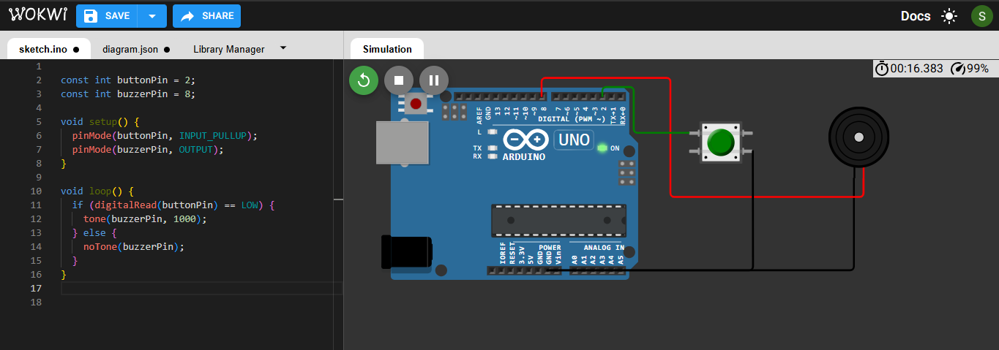
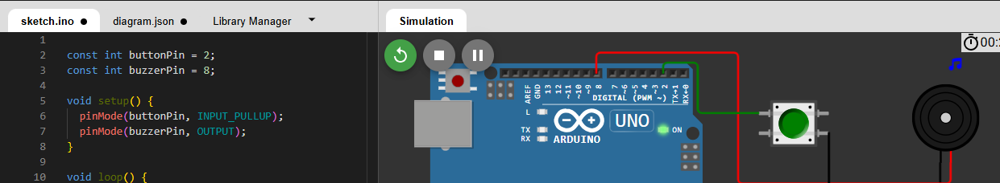
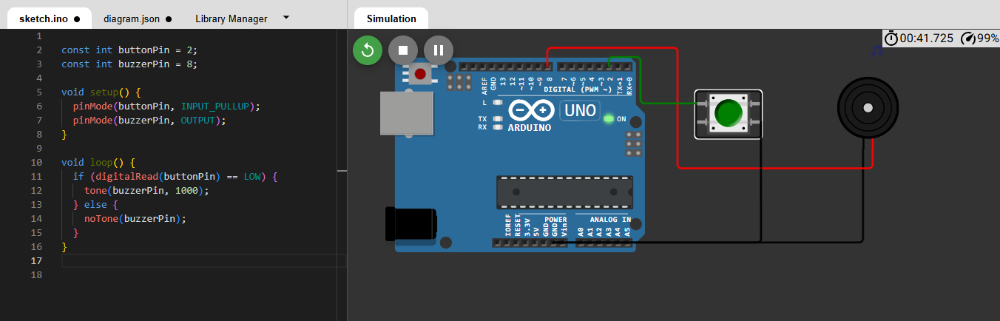

Doorbell System with Arduino Uno
This project demonstrates a simple doorbell system using an Arduino Uno, a push button, and a buzzer. The buzzer sounds only while the push button is pressed and stops when it is released.
Components Used
Arduino Uno
Push button
Buzzer
Jumper wires
Circuit Connections

Component Arduino Connection
Push button contact 1 -D2 
Push button contact 2 -GND
Buzzer positive (+) -D8 
Buzzer negative (-) -GND 

The push button uses the Arduino's internal pull-up resistor, so an external pull-up resistor is not required.

Working Principle
The Arduino continuously checks the state of the push button. When the button is pressed, the input reads LOW and the buzzer generates a 1000 Hz tone. When the button is released, the buzzer stops immediately.

## Source Code
The complete Arduino program is available in [`sketch.ino`](sketch.ino).

Procedure
1. Open the Arduino Uno simulation in Wokwi.
2. Add a push button and a buzzer.
3. Connect the push button to D2 and GND.
4. Connect the buzzer positive terminal to D8 and its negative terminal to GND.
5. Upload the Arduino program.
6. Start the simulation and test the button.
7. Verify that the buzzer sounds only while the button is pressed.

Output Screenshots
Button Released

Button Pressed

Simulation Link
https://wokwi.com/projects/479142666384545793

Conclusion
The project demonstrates the use of Arduino digital input and output to control a buzzer. The required doorbell behaviour was achieved when the buzzer sounded during button presses and stopped upon release.
